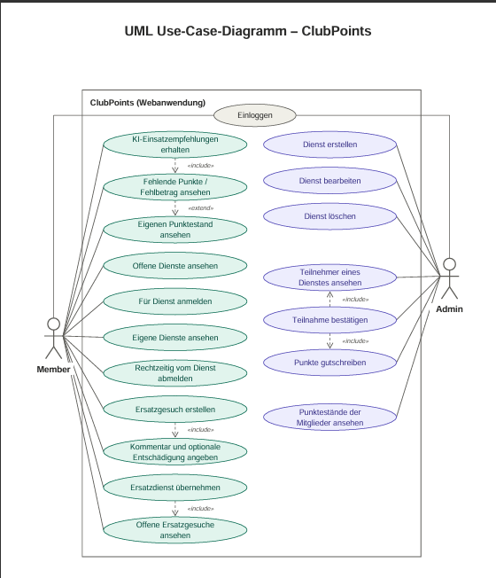
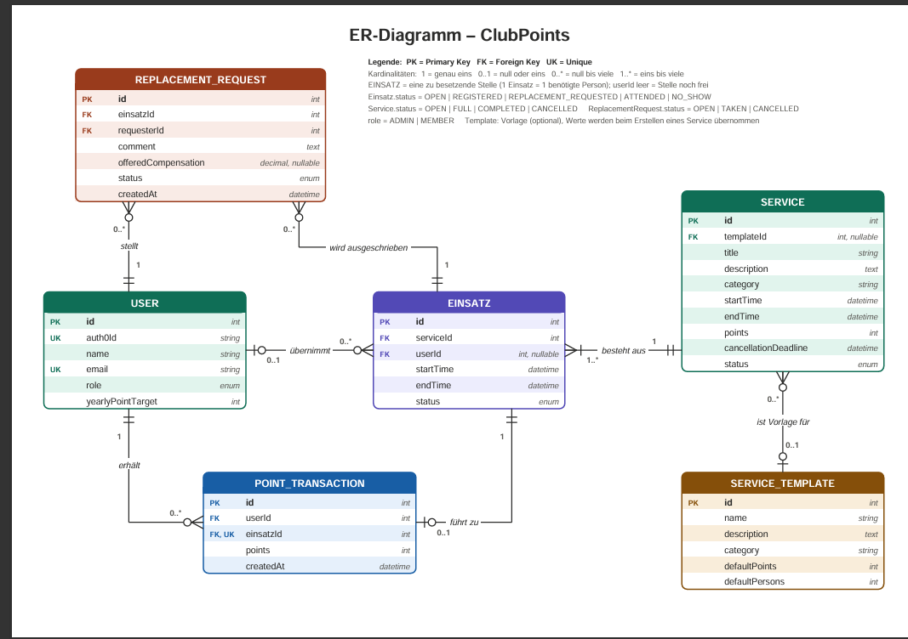

# ClubPoints

Webanwendung zur Verwaltung eines Punktesystems in einem Fussballverein. Mitglieder sammeln durch Helfereinsätze Punkte und können ihre Einsätze sowie ihren aktuellen Punktestand verwalten.

# Inhaltsverzeichnis
- [Einleitung](#einleitung)
- [Boards](#boards)
    - [Explore-Board](#explore-board)
    - [Create-Board](#create-board)
    - [Evaluate-Board](#evaluate-board)
    - [Diskussion Feedback Pitch](#diskussion-feedback-pitch)
- [Anforderungen](#anforderungen)
    - [Use-Case Diagramm](#use-case-diagramm)
    - [Fachliches Datenmodell](#fachliches-datenmodell)
    - [UI-Mockup](#ui-mockup)
- [Implementation](#implementation)
    - [Frontend](#frontend)
    - [KI-Funktionen](#ki-funktionen)
    - [Optionale Anforderungen](#optionale-anforderungen)
- [Fazit](#fazit)
    - [Stand der Implementation](#stand-der-implementation)

# Einleitung

ClubPoints ist eine Webanwendung für einen Fussballverein.

Jedes Mitglied muss pro Jahr 20 Punkte durch Helfereinsätze sammeln. Solche Einsätze können beispielsweise Schiedsrichtereinsätze, Foodtruck-Dienste, Hallenturniere oder Auswärtsfahrten sein.

Ein fehlender Punkt entspricht CHF 20.

Die Anwendung soll die Verwaltung dieser Dienste vereinfachen. Administratoren können Dienste erstellen und Mitgliedern zuweisen. Mitglieder können ihren Punktestand und ihre Einsätze einsehen und sich bei Verhinderung abmelden. Bei kurzfristigen Absagen können sie über eine Funktion "Ersatz gesucht" andere Mitglieder um eine Übernahme bitten.

# Boards

## Explore-Board

### TRENDS & TECHNOLOGIE

- Digitalisierung der Vereinsorganisation
- Webbasierte Vereinsverwaltung
- Automatische Benachrichtigungen
- Digitale Verwaltung von Helfereinsätzen
- Übersicht über persönliche Punktestände
- Self-Service für Vereinsmitglieder

### POTENTIELLE PARTNER & WETTBEWERB

- Fussballvereine
- Andere Sportvereine mit Helfersystemen
- Vereinsverwaltungssoftware
- Veranstalter von Turnieren und Vereinsanlässen
- Regionale Fussballverbände

Mögliche Partner sind vor allem Vereine, welche ebenfalls Helfereinsätze organisieren müssen. Sie könnten ClubPoints als digitales Verwaltungssystem einsetzen.

### FAKTEN

- Der Verein hat rund 700 Mitglieder.
- Jedes Mitglied muss jährlich 20 Punkte sammeln.
- Ein Punkt entspricht CHF 20.
- Fehlende Punkte werden am Jahresende verrechnet.
- Punkte werden durch Vereinsdienste gesammelt.
- Der Administrator teilt Dienste zu.
- Mitglieder können sich bei Verhinderung abmelden.
- Bei kurzfristiger Absage kann ein Ersatz gesucht werden.
- Mitglieder können anderen Mitgliedern einen Anreiz für die Übernahme anbieten.

### USER

**Mitglieder**
- Fussballspieler und andere Vereinsmitglieder
- Müssen jährlich ihre Punkte sammeln
- Möchten ihre Einsätze und Punkte einfach sehen
- Möchten Einsätze unkompliziert verwalten können

**Administrator**
- Verwaltet Vereinsdienste
- Teilt Mitglieder zu Diensten ein
- Kontrolliert die gesammelten Punkte
- Verwaltet offene und besetzte Einsätze

### POTENZIALFELDER

- Einfachere Verwaltung von Vereinsdiensten
- Transparente Punkteübersicht
- Schnellere Suche nach Ersatzpersonen
- Weniger organisatorischer Aufwand für den Verein
- Bessere Kommunikation zwischen Mitgliedern und Administratoren

### ERKENNTNISSE

- Die Organisation von Helfereinsätzen verursacht viel administrativen Aufwand.
- Mitglieder möchten frühzeitig wissen, wann sie eingeteilt wurden.
- Kurzfristige Absagen sind schwierig zu organisieren.
- Mitglieder möchten jederzeit wissen, wie viele Punkte sie bereits gesammelt haben.
- Eine zentrale Plattform kann Kommunikation und Organisation vereinfachen.

### BEDÜRFNISSE

- Einfache Übersicht über eigene Dienste
- Übersicht über den persönlichen Punktestand
- Einfache Abmeldung bei Verhinderung
- Schnelle Suche nach Ersatz
- Weniger manueller Verwaltungsaufwand
- Klare Kommunikation über neue Einsätze

### TOUCHPOINTS

- Login in die Webanwendung
- Persönliches Dashboard
- Übersicht der Dienste
- Benachrichtigung über eine neue Zuteilung
- Abmeldung von einem Dienst
- Ersatz-gesucht-Funktion
- Übernahme eines offenen Dienstes
- Anzeige des Punktestandes

### WIE KÖNNEN WIR?

Wie können wir die Verwaltung von Helfereinsätzen und Vereinspunkten so digitalisieren, dass Mitglieder ihre Einsätze einfach verwalten können und gleichzeitig der administrative Aufwand für den Verein reduziert wird?

## Create-Board

### IDEEN-BESCHREIBUNG

ClubPoints ist eine Webanwendung, mit der ein Verein Helfereinsätze und die dazugehörigen Punkte zentral verwalten kann. Mitglieder können ihre Einsätze und Punkte einsehen sowie bei Bedarf selbständig Ersatz suchen.

### ADRESSIERTE NUTZER

- Vereinsmitglieder
- Administratoren des Vereins

### ADRESSIERTE BEDÜRFNISSE

- Übersicht über Einsätze
- Übersicht über gesammelte Punkte
- Einfache Organisation von Ersatz
- Automatische Information bei neuen Zuteilungen
- Weniger Verwaltungsaufwand

### PROBLEME

- Hoher manueller Verwaltungsaufwand
- Unübersichtliche Punkteverwaltung
- Schwierige Ersatzsuche bei kurzfristigen Absagen

### IDEENPOTENZIAL

**Mehrwert für Nutzer: 8/10**

🔵🔵🔵🔵🔵🔵🔵🔵⚪️⚪️

Die Anwendung vereinfacht sowohl die Organisation für den Verein als auch die Verwaltung der Einsätze für die Mitglieder.

**Übertragbarkeit: 7/10**

🔵🔵🔵🔵🔵🔵🔵⚪️⚪️⚪️

Das Konzept kann neben Fussballvereinen auch für andere Sportvereine und Organisationen mit Helfereinsätzen verwendet werden.

**Machbarkeit: 3/10**

🔵🔵🔵⚪️⚪️⚪️⚪️⚪️⚪️⚪️

Die grundlegenden Funktionen können mit bekannten Webtechnologien und einer Datenbank umgesetzt werden.

### DAS WOW

Mitglieder können bei einer kurzfristigen Absage direkt innerhalb der Anwendung Ersatz suchen. Andere Mitglieder sehen die Anfrage und können den Einsatz übernehmen.

### HIGH-LEVEL-KONZEPT

ClubPoints ist wie ein digitaler Einsatzplan kombiniert mit einem persönlichen Punktekonto für Vereinsmitglieder.

### WERTVERSPRECHEN

ClubPoints bietet eine zentrale und einfache Lösung für die Organisation von Vereinsdiensten und macht den aktuellen Punktestand für jedes Mitglied transparent.

## Evaluate-Board

### KANÄLE

Da ClubPoints primär innerhalb eines Vereins genutzt wird:

- Vereinswebsite
- Direkter Link zur Webanwendung
- E-Mail
- Vereins-Newsletter
- WhatsApp-Gruppen
- Interne Kommunikation durch Trainer und Vereinsleitung

### UNFAIRER VORTEIL

- Spezifische Anpassung an das bestehende Punktesystem des Vereins
- Direkte Verbindung von Helfereinsätzen und Punktestand
- Integrierte Ersatz-gesucht-Funktion
- Ausrichtung auf die tatsächlichen Abläufe des Vereins

### KPI

Mögliche Messgrössen:

- Anzahl aktiver Nutzer
- Anzahl verwalteter Dienste
- Anzahl erfolgreich vermittelter Ersatzdienste
- Anteil vollständig erfüllter Punktekonten
- Anzahl kurzfristig unbesetzter Dienste
- Zeitaufwand der Administratoren für die Einsatzplanung

### EINNAHMEQUELLEN

ClubPoints ist primär als interne Vereinsanwendung gedacht.

Mögliche Finanzierung:

- Finanzierung über Vereinsbudget
- Mitgliederbeiträge
- Später eventuell Lizenzmodell für andere Vereine

## Diskussion Feedback Pitch

Noch kein Feedback vorhanden.

Dieser Bereich wird nach der Präsentation bzw. dem Pitch mit erhaltenem Feedback und den daraus abgeleiteten Änderungen ergänzt.

# Anforderungen

## Use-Case Diagramm

Hier wird das Use-Case-Diagramm eingebunden.

Beispiel:

## Fachliches Datenmodell

Hier wird das ER-Diagramm eingebunden.

Beispiel:

Das fachliche Datenmodell beschreibt die wichtigsten Entitäten und deren Beziehungen innerhalb von ClubPoints.

## UI-Mockup

Noch nicht Bestandteil dieser Abgabe.

# Implementation

## Frontend

Noch nicht implementiert.

## KI-Funktionen

Noch nicht implementiert.

## Optionale Anforderungen

Noch nicht implementiert.

# Fazit

## Stand der Implementation

Aktueller Stand:

- Projektidee definiert
- Explore-Board erstellt
- Create-Board erstellt
- Evaluate-Board erstellt
- Use-Case-Diagramm erstellt
- Fachliches Datenmodell / ER-Diagramm erstellt

Die technische Implementation der Anwendung folgt in den nächsten Projektphasen.